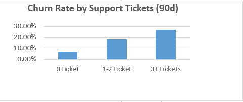
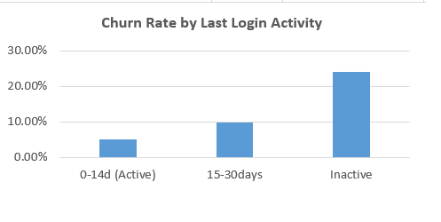
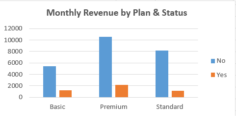

# Customer Churn Analysis & Retention Action Plan (Excel)

## 📌 Project Overview
Analyzed **750 subscription customer records** in Microsoft Excel to quantify churn rates across segments, identify early-warning behavioral signals, and design an actionable retention strategy for the Customer Success team.

---

## 📊 Key Business Findings
* **Overall Churn Rate:** **16.27%** (122 churned customers out of 750), representing **$4,598/month** in lost recurring revenue (MRR) out of $28,770 total MRR.
* **Subscription Plan & Revenue at Risk:** While the **Basic** plan has the highest churn rate (**18.39%**), the **Premium** plan ($79/mo) combines high churn (**17.28%**) with the largest financial loss—accounting for **$2,212/month** (48.1% of total lost MRR).
* **Customer Tenure:** Newer and mid-tenure customers (**0–24 months**, ~19.8% churn) are significantly more likely to churn than long-term subscribers (**24+ months**, 12.63% churn).
* **Regional & Payment Trends:** The **East** region shows a notably higher churn rate (**23.33%**) compared to North (**11.34%**). Invoice payers also churn slightly more (**17.95%**) than Card (**15.82%**) or PayPal (**15.38%**) users.

---

## 🚨 Top 3 Early-Warning Signals (Behavioral Associations)
1. **Support Friction (90d Tickets):** Customers with **3+ support tickets** churn at **26.84%**—nearly **4x higher** than customers with 0 tickets (**7.01%**).
2. **Inactivity (Days Since Last Login):** Churn jumps nearly **5x** from **5.03%** among active users (0–14 days) to **24.18%** among inactive users (**30+ days**).
3. **Low Engagement (Monthly Usage):** Low-usage customers (**<15 hours/month**) churn at **22.46%**, nearly double the rate of heavy users (**11.97%** for 25+ hours).

---

## 🎯 Simple "At-Risk" Rule for Customer Success
Flag any **active** customer (`Churned = No`) as **At-Risk** if they meet at least **ONE** of the following criteria:
* No login for **more than 30 days**, **OR**
* **3 or more support tickets** in the last 90 days.

*(Priority Tier 1: Flagged active customers on the **Premium** plan).*

---

## 💡 Retention Recommendations (Who, What, Expected Impact)
* **Action 1: Proactive High-Touch Outreach for Support Friction**
  * **Who:** Customer Success Managers (CSMs)
  * **What:** Conduct 1-on-1 check-in calls with active customers who logged **3+ support tickets** (prioritizing Premium accounts) to confirm technical issues are fully resolved.
  * **Expected Impact:** Reduce churn in this high-friction segment by **15–20%**, protecting ~$350–$450/month in MRR.
* **Action 2: Automated Re-Engagement Campaign**
  * **Who:** Lifecycle Marketing & Product Teams
  * **What:** Trigger automated re-engagement emails and in-app onboarding tips when a user hits **15–30 days of inactivity** (before entering the 30+ day danger zone).
  * **Expected Impact:** Reduce churn among inactive users by **10–15%**.
* **Action 3: East Region & Early-Tenure Onboarding Audit**
  * **Who:** Regional Operations & Customer Onboarding Teams
  * **What:** Audit service quality in the East region and introduce a structured 90-day onboarding sequence for new customers (0–6 months) to boost monthly usage above 15 hours.
  * **Expected Impact:** Lower early-tenure and regional churn by **10–12%**.

---

## 🖼️ Project Visuals & Dashboard

### 1. Executive Memo & Action Plan

### 2. Segment Analysis & Pivot Tables

### 3. Key Churn Drivers (Charts)

---

## 📁 Repository Files
* `customer_churn.xlsx` — Complete Excel workbook containing `Executive Memo`, `Analysis & Chart` (Pivot Tables & visuals), `Cleaned_Data` (feature bucketing), and `Raw_Data`.
